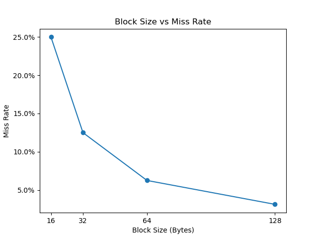
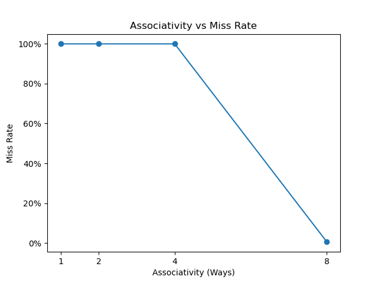

# Cache Simulator
A simple cache simulator implemented in C++ for studyingcache memory organization.

## Current Configuration

- 32-bit address
- Cache size : 32 KB
- Configurable block size
- Configurable associativity ('WAYS')
- Set-associative cache
- LRU replacement policy
- Configurable Write-through / Write-back policy
- Configurable Write-allocate / No-write-allocate policy

## Implemented

- Address decomposition (Tag / Index / Block Offset)
- Memory trace file input
- Read / Write memory access support
- Cache hit/miss detection and statistics
- Configurable cache size, block size, and associativity
- LRU replacement policy using access timestamps
- Write-through policy
- Write-back policy using dirty bits
- Write-allocate policy
- No-write-allocate policy
- Memory write traffic measurement

## Experimental Results

### Effect of Block Size

To analyze the effect of spatial locality, the simulator was tested with sequential memory accesses while varying the cache block size

#### Configuration

- Cache Size: 32 KB
- Associativity: Direct-mapped (1-way)
- Memory Accesses: 1024
- Access Pattern: Sequential integer accesses (4 bytes apart)

#### Results

| Block Size | Hits | Misses | Miss Rate |
|------------|------|--------|-----------|
| 16 B | 768 | 256 | 25% |
| 32 B | 896 | 128 | 12.5% |
| 64 B | 960 | 64 | 6.25% |
| 128 B | 992 | 32 | 3.125% |



#### Analysis

Since the trace accesses consecutive memory addresses, it exhibits strong spatial locality.

When a cache block is loaded on a miss, subsequent accesses to nearby integers within the same block result in cache hits. As the block size increases, more consecutive integers are fetched by a single cache miss, reducing the overall miss rate

This experiment demonstrates how spatial locality can reduce cache misses when a larger block contains data that will be accessed in the near future.

### Effect of Associativity

To analyze the effect of cache associaticity on conflict misses, the simulator was tested with multiple memory blocks that map to the same cache set.

#### Configuration

- Cache size = 32 KB
- Block size = 64 B
- Associativity: 1-way, 2-way, 4-way, 8-way
- Memory Accesses: 1000
- Access Pattern: Five memory blocks mapping to the same cache set

#### Results

| Associativity | Hits | Misses | Miss Rate |
|---------------|------|--------|-----------|
| 1-way | 0 | 1000 | 100% |
| 2-way | 0 | 1000 | 100% |
| 4-way | 0 | 1000 | 100% |
| 8-way | 995 | 5 | 0.5% |



#### Analysis

The trace repeatedly accesses five memory blocks that map to the same cache set.

With 1-way, 2-way, and 4-way associativity, the cache set cannot hold all five blocks simultaneously. Therefore, blocks are continuously replaced by the LRU replacement policy, resulting in frequent conflict misses.

With 8-way associativity, all five blocks can remain in the same set. After the first five compulsory misses, the remaining accesses result in cache hits.

This experiment demonstrates that increasing cache associativity can reduce conflict misses when multiple memory blocks compete for the same cache set.

### Effect of Write Policy
To analyze the effect of cache write policies, the simulator was tested with Write-through, Write-back, Write-allocate, and No-write-allocate policies.

#### Write-through vs Write-back

The first experiment compares Write-through and Write-back using the same memory access trace.

#### Configuration

- Cache Size : 32KB
- Block Size : 64B
- Associativity : Direct-mapped (1-way)
- Allocation Policy : Write-allocate
- Memory Accesses : 5

#### Access Pattern

```text
W 10000000
W 10000004
W 10000008
W 1000000C
R 10008000
```

The first four write operations access the same cache block. The final read accesses another block that maps to the same cache set, forcing the modified block to be evicted.

#### Results

| Write Policy | Hits | Misses | Memory Writes |
|--------------|------|--------|---------------|
| Write-through | 3 | 2 | 4 |
| Write-back | 3 | 2 | 1 |

#### Analysis

Both policies produce the same number of cache hits and misses because the cache organization and memory access pattern are identical.

With Write-through, every write operation immediately updates main memory. Therefore, the four write operations generate four memory writes.

With Write-back, write operations modify only the cache block and set its dirty bit. Main memory is updated when the dirty block is evicted. As a result, the four cache writes generate only one memory write when the block is replaced.

This experiment demonstrates that Write-back can reduce memory write traffic when the same cache block is modified repeatedly.

### Write-allocate vs No-write-allocate

The second experiment compares how the cache handles a write miss under Write-allocate and No-write-allocate policies.

#### Access Pattern

```text
W 10000000
R 10000000
```

#### Results

| Allocation Policy | Hits | Misses | Miss Writes |
|--------------|------|--------|---------------|
| Write-allocate | 1 | 1 | 50% |
| No-write-allocate| 0 | 2 | 100% |

#### Analysis

With Write-allocate, the block is loaded into the cache when the first write miss occurs. Therefore, the following read to the same address results in a cache hit.

With No-write-allocate, the write miss updates main memory without loading the block into the cache. Therefore, the following read cannot find the block in the cache and results in another cache miss.

This experiment demonstrates that the allocation policy determines whether a block is brought into the cache after a write miss and can affect subsequent cache hit/miss behavior.

## Future Work

- Multi-level cache (L1 / L2)
- Local and global miss rate analysis
- AMAT calculation
- Additional cache performance experiments